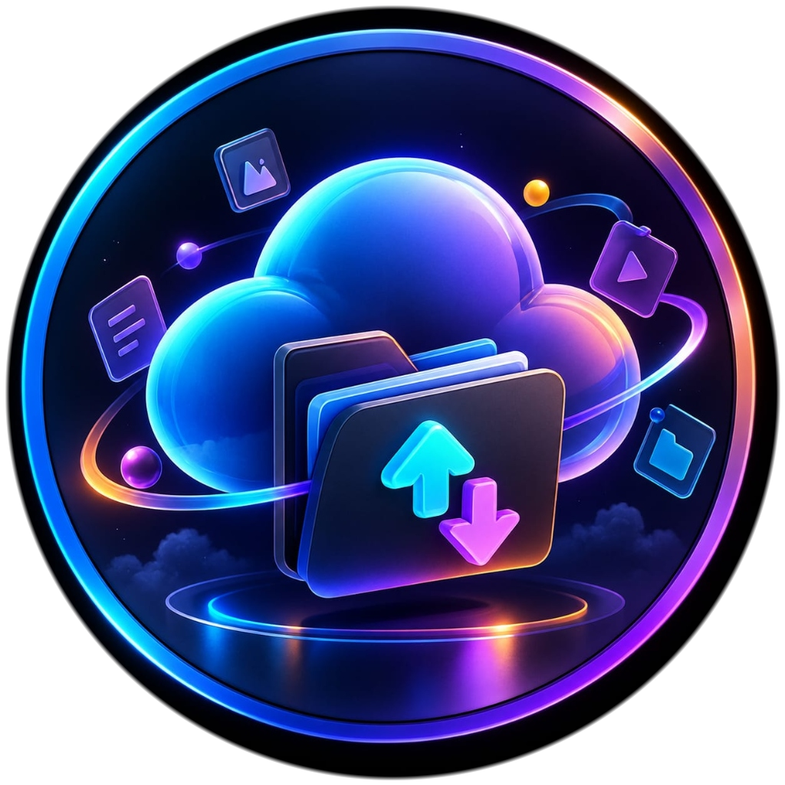
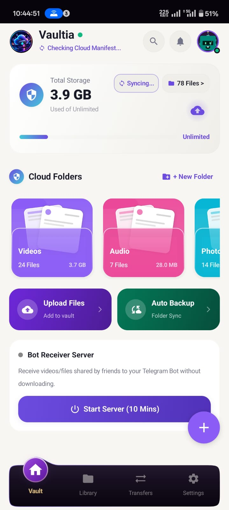
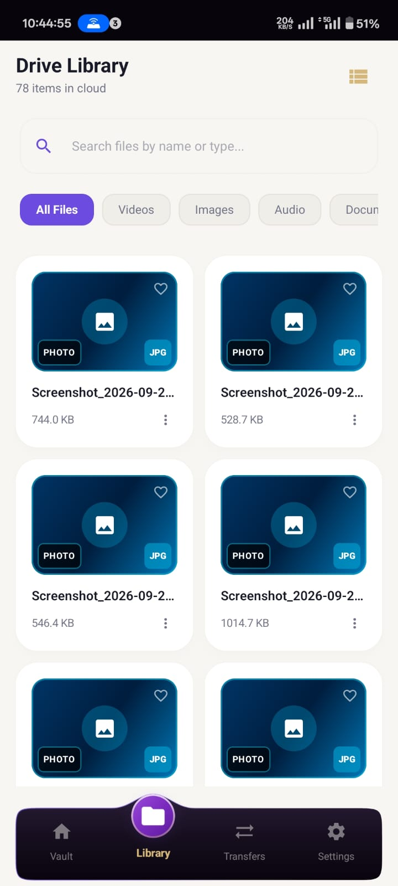
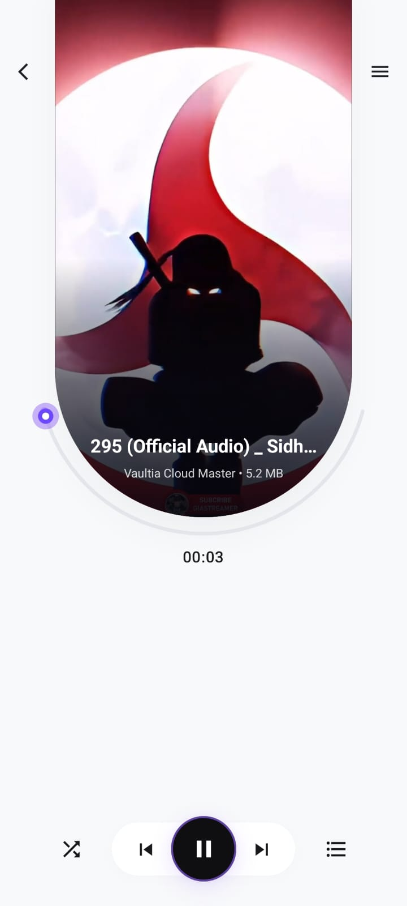
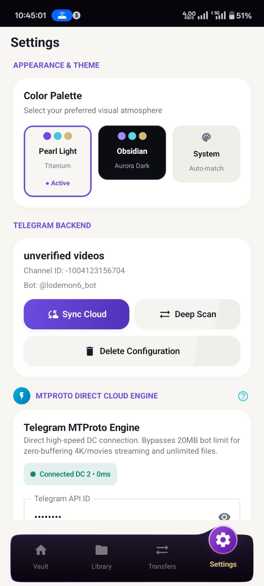
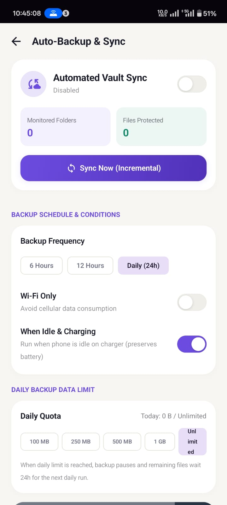
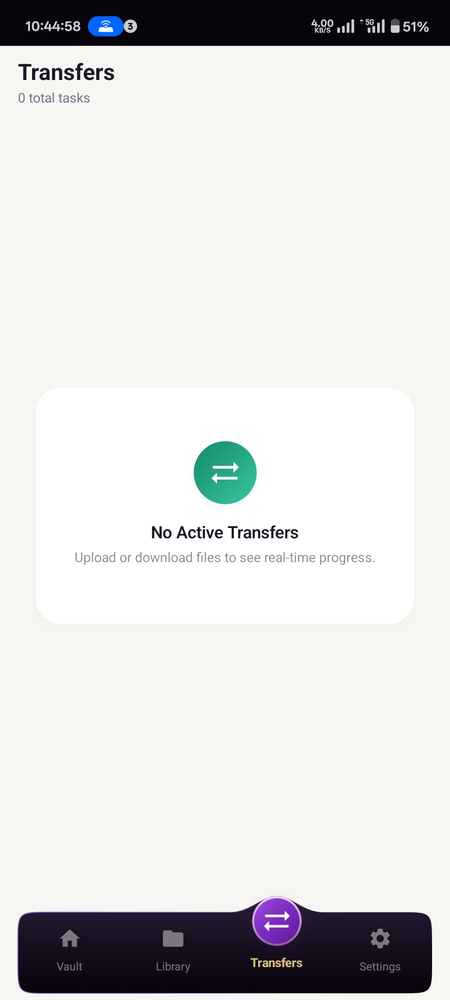

<div align="center">

# ⚡ Vaultia
### Unlimited Telegram Cloud Storage, Real-Time MTProto Streaming & Encrypted Media Vault

<p align="center">
  
</p>

[](https://github.com/sentinal404/Vaultia/releases/tag/v2.0.0)
[-3DDC84?style=for-the-badge&logo=android&logoColor=white)](https://android.com)
[](https://kotlinlang.org)
[](https://developer.android.com/jetpack/compose)
[](https://core.telegram.org/mtproto)
[](LICENSE)
[](#-vibe-coding-origin)
[](https://www.linkedin.com/in/rishishakya)

<p align="center">
  <b>Turn your private Telegram channels into an infinite, zero-cost personal cloud drive.</b><br>
  Instant zero-buffering 4K video playback via direct MTProto binary chunk streaming, multi-worker parallel uploads, hardware AES-256 client-side encryption, and auto folder synchronization wrapped in a 2026 Tactile Claymorphism UI.
</p>

[Key Features](#-key-features) • [Screenshots](#-interface-gallery) • [Architecture](#-architecture--how-it-works) • [Android Studio Setup](#-android-studio-import--developer-setup) • [Security & Privacy](#-security--privacy-first) • [Releases](#-releases--download) • [Connect on LinkedIn](https://www.linkedin.com/in/rishishakya)

</div>

---

## 📸 Interface Gallery

Vaultia features a refined 2026 **Tactile Claymorphism & Obsidian/Pearl Design System** with dynamic 3D glassmorphic elements, a physics-driven floating curved bottom navigation bar, and an immersive media player experience.

### 🌌 Primary Views & Player

| 🏠 Vault Dashboard | 📂 Drive Library Grid | 🎵 Hi-Fi Audio Player (Anime & Video) |
| :---: | :---: | :---: |
|  |  |  |
| *Real-time storage metric, 3D translucent folders & cloud actions* | *Instant media cards, filter chips, circular badges & search* | *Extended arch container, dynamic anime art/video & violet arc scrubber* |

### ⚙️ System Controls & Automation

| ⚙️ MTProto Engine & Settings | 🔄 Auto-Backup & Sync Schedule | ⚡ Transfers Engine |
| :---: | :---: | :---: |
|  |  |  |
| *Direct DC connection ping (0ms), theme palette & Bot API credentials* | *Automated vault sync, conditions (Wi-Fi, Idle, Charging) & quotas* | *Real-time multi-worker upload/download queue progress* |

---

## 🚀 Key Features

### 1. ♾️ Unlimited Telegram Cloud Backend
- Leverages your private Telegram channels as an infinite, cost-free, decentralized remote vault.
- No third-party servers, no middleman tracking, and zero subscription fees.
- All files remain safely hosted on Telegram's global data center network.

### 2. ⚡ Direct MTProto Chunk Streaming Engine (Zero Buffering)
- **Bypasses the 20MB Bot API limitation**: Directly connects to Telegram DC servers via binary MTProto protocol to stream large files (up to 2GB each).
- **On-Demand 512KB HTTP Range Streaming**: Media player requests only the specific byte chunks needed in real time.
- **Zero Storage Bloat & Instant Seek**: Does **NOT** download full gigabyte files to phone RAM or internal storage before playing. Enjoy instantaneous seek and smooth 4K playback.

### 3. 🤖 Multi-Worker Parallel Upload Pipeline
- Distribute heavy uploads across multiple secondary Telegram worker bots configured as channel administrators.
- Files are sliced into verified chunks with SHA-256 integrity verification.
- Automatically balances load across workers to stay well clear of Telegram flood and rate limits.
- Fully resumable: interrupted uploads resume from the exact last missing chunk.

### 4. 🔄 Auto Folder Sync & Background Backup
- Select local folders (`DCIM/Camera`, `WhatsApp Documents`, `Downloads`, etc.) for continuous monitoring.
- Powered by Android `WorkManager` with battery-friendly background scheduling.
- Automatically uploads new images, videos, and documents to the cloud vault without manual intervention.

### 5. 📡 Built-In Bot Receiver Server
- Run a lightweight receiver loop directly on your device.
- Send or forward any video, audio, or document to your Telegram bot from another phone or PC — Vaultia automatically captures, indexes, and organizes the media into your vault.

### 6. 🛡️ Hardware-Backed AES-256 Client-Side Encryption
- Optional end-to-end client-side encryption using hardware-backed **AES-256-GCM** via the Android KeyStore.
- Files are encrypted before leaving your phone — Telegram servers only store encrypted byte chunks.
- Biometric authentication (Fingerprint / Face Unlock) and fallback security PIN for app access.

### 7. 🎨 Tactile Claymorphism UI
- Handcrafted custom design system featuring soft dual shadows, pill navigation, tactile buttons, and reactive animations.
- Full dual-palette support: **Obsidian Dark** (OLED pitch black with aurora glow) and **Pearl Titanium Light** (paper clay surfaces with accessible contrast).

### 8. 🎵 Modern Hi-Fi Audio Player (Dynamic Anime Artworks & Video Loops)
- **Extended Arch Container**: Touches the top screen edge with camera notch/cutout safe gutters and extends down to a deep rounded U-curve (~61% screen height) to showcase full character portraits and illustrations.
- **Alternating Video & Image Mode**:
  - Automatically alternates **Anime Image ↔ Looping Video** on every track change (`Image -> Video -> Image -> Video`).
  - Curated library of **22 dynamic anime artworks** and **4 high-quality looping short videos**.
  - **100% Muted Background Video**: Strictly muted (`volume = 0f`) so video audio never merges with your music.
  - **Seamless Repeat Loop**: Videos repeat infinitely until the track changes or completes.
  - Play/pause state is synchronized with audio playback.
  - Interactive tap-to-shuffle allows cycling through media within the active mode.
- **Concentric Arc Progress Scrubber**:
  - Electric violet progress arc hugging the bottom curve with a dual-ring neon glowing thumb.
  - Monotonic polar angle math with drift-safe quadrant normalization.
- **Floating Controls Dock**:
  - Anchored to the bottom with Shuffle, Previous, Next, and working Queue modal sheet.
  - Elevated circular Play/Pause button with an ambient 360° neon violet halo that pops above the dock.

---

## 🏗️ Architecture & How It Works

Vaultia operates entirely client-side on Android with clean MVVM + Repository architecture:

```
┌─────────────────────────────────────────────────────────────┐
│                    Presentation Layer                       │
│    Jetpack Compose • Tactile Claymorphism • Custom Shapes   │
└──────────────────────────────┬──────────────────────────────┘
                               │
┌──────────────────────────────▼──────────────────────────────┐
│                      ViewModel Layer                        │
│   VaultViewModel • TransferViewModel • PlayerViewModel      │
└──────────────────────────────┬──────────────────────────────┘
                               │
┌──────────────────────────────▼──────────────────────────────┐
│                    Domain & Engine Core                     │
│  ┌───────────────────────┐       ┌──────────────────────┐  │
│  │ ChunkEngine (SHA-256) │       │ Upload/Download Mgr  │  │
│  └───────────────────────┘       └──────────────────────┘  │
│  ┌───────────────────────┐       ┌──────────────────────┐  │
│  │ MediaStreamingServer  │◄─────►│ MTProto Chunk Engine │  │
│  │  (127.0.0.1:8080)     │       │   (Direct DC Range)  │  │
│  └───────────────────────┘       └──────────────────────┘  │
└──────────────┬──────────────────────────────┬───────────────┘
               │                              │
┌──────────────▼─────────────┐ ┌──────────────▼───────────────┐
│        Local Data          │ │        Remote Cloud          │
│ • Room Database (SQLite)   │ │ • Telegram Bot API Gateway   │
│ • EncryptedSharedPreferences│ │ • Telegram MTProto Binary DC │
│ • Android KeyStore AES-256 │ │ • Zero-Middleware Connection │
└────────────────────────────┘ └──────────────────────────────┘
```

### Streaming Mechanism
1. The ExoPlayer instance requests media from the local streaming endpoint `http://127.0.0.1:8080/stream/{fileId}`.
2. The internal server parses the incoming HTTP `Range: bytes=start-end` request.
3. The **MTProto Chunk Engine** queries Telegram's direct CDN / DC servers, fetching precisely the 512KB slices required.
4. Chunks are streamed through the local loopback socket straight into the video decoder with zero temp disk writes.

---

## 🛠️ Android Studio Import & Developer Setup

Vaultia is built with modern Android tooling and can be opened in Android Studio or compiled purely from the command line.

### Prerequisites
- **Android Studio**: Iguana (2023.2.1), Jellyfish, Koala, Ladybug, or later.
- **JDK**: Java Development Kit 17 (e.g. Eclipse Adoptium Temurin 17 or OpenJDK 17).
- **Android SDK**: Compile SDK `34`, Min SDK `26` (Android 8.0+).
- **NDK** *(Optional)*: NDK 26+ if building custom C++ JNI bindings.

---

### Step 1: Clone the Repository
```bash
git clone https://github.com/sentinal404/Vaultia.git
cd Vaultia
```

### Step 2: Open in Android Studio
1. Launch **Android Studio**.
2. Click **Open** (or **File → Open...**).
3. Select the `Vaultia` root folder.
4. Allow Android Studio to complete the initial **Gradle Sync**.

> [!NOTE]
> Gradle will automatically download the required dependencies including Jetpack Compose 1.5.14, ExoPlayer Media3 1.3.1, Room 2.6.1, and Retrofit 2.11.0.

---

### Step 3: Command Line Build (Alternative)

If you prefer building directly from PowerShell or Bash without opening Android Studio:

#### Linux / macOS
```bash
./gradlew assembleDebug
# The APK will be generated at: app/build/outputs/apk/debug/app-debug.apk
```

#### Windows PowerShell
```powershell
.\gradlew.bat assembleDebug
```

To build a Release APK:
```powershell
.\gradlew.bat assembleRelease
```
*(Release builds gracefully skip keystore signing if private `.jks` keys are not present in your environment).*

---

### Step 4: Run on Device / Emulator
1. Enable **Developer Options** and **USB Debugging** on your Android device.
2. Connect your device via USB or start an Android Emulator.
3. In Android Studio, click the green **Run (▶)** button, or use ADB:
```bash
adb install -r app/build/outputs/apk/debug/app-debug.apk
adb shell am start -n com.vaultia.app/.MainActivity
```

---

## ⚙️ Configuration & Getting Started

When launching Vaultia for the first time, follow the in-app onboarding wizard:

1. **Create a Telegram Bot**:
   - Open Telegram and message [@BotFather](https://t.me/BotFather).
   - Use `/newbot` to create your bot and copy your API Token.
2. **Create a Private Storage Channel**:
   - Create a new Telegram Channel set to **Private**.
   - Add your newly created Bot as an **Administrator** with full posting permissions.
3. **Get Channel Chat ID**:
   - Forward a message from your channel to [@userinfobot](https://t.me/userinfobot) or use the channel's `-100...` format ID.
4. **(Optional) MTProto Streaming Credentials**:
   - To unlock direct MTProto 4K streaming up to 2GB files, obtain your `api_id` and `api_hash` from [my.telegram.org](https://my.telegram.org) and enter them in **Settings → Telegram MTProto Engine**.

---

## 🔒 Security & Privacy First

Vaultia is built with strict privacy and zero-trust security principles:

- 🛡️ **Zero Hardcoded Secrets**: No bot tokens, channel IDs, or hashes exist in the codebase. All credentials are user-supplied and encrypted on the local device.
- 🔐 **Android Keystore Isolation**: Master encryption keys are protected using hardware-backed cryptographic hardware (TEE / StrongBox).
- 🚫 **No Tracking / No Telemetry**: Vaultia contains zero analytics SDKs, zero crash reporters, and zero trackers. All network packets communicate directly with Telegram DC servers.
- 🚨 **Vulnerability Reporting**: See our comprehensive [SECURITY.md](SECURITY.md) for vulnerability disclosure procedures and private reporting options.

---

## 📦 Releases & Download

Download the official production APK from GitHub Releases:

👉 **[Download Latest Vaultia Release](https://github.com/sentinal404/Vaultia/releases)**

| Release Asset | Description | Size |
| :--- | :--- | :---: |
| `vaultia-v2.0.0-release.apk` | **Vaultia v2.0.0 (Evolution Edition)**: Complete 2026 UI redesign, curved floating bottom nav, 5 dynamic auto-theming audio players (including Arch Arc Scrubber), true immersive fullscreen 4K video player, multi-select cloud batch actions, 3D glassmorphic folders, and native TDLib MTProto engine | ~105 MB |
| `vaultia-v1.0.0-release.apk` | **Vaultia v1.0.0 Production**: Initial stable release featuring direct TDLib MTProto engine for 2GB zero-buffering 4K streaming and claymorphic UI | ~105 MB |

---

## 💖 Crafted with Vibe Coding

Vaultia was designed and developed with pure **Vibe Coding** — an iterative, human-in-the-loop pair-programming methodology combining creative product vision with autonomous agentic intelligence.

- **100% Fully Working & Production Verified**: Real-world tested on physical Android devices (Android 8.0 through 14) with multi-gigabyte 4K video playback, biometric security, and multi-worker Telegram bot concurrency.
- **Hardware Encryption & Native C++ TDLib**: Seamlessly integrates native `libtdjni.so` binary MTProto pipelines with hardware-backed Android KeyStore AES-256-GCM.

---

## 🌟 Support & Connect

If you love the concept of infinite zero-cost personal cloud storage:

- ⭐ **Star this Repository!** Give Vaultia a GitHub star to support independent open-source tools.
- 🤝 **Connect with me on LinkedIn**: [**Rishi Shakya**](https://www.linkedin.com/in/rishishakya) (Let's connect & discuss vibe coding and Android architectures!)
- 🐛 **Found a Vulnerability?**: Report it privately via [SECURITY.md](SECURITY.md).

---

## 📜 License

This project is licensed under the Apache License 2.0. See the [LICENSE](LICENSE) file for details.

---

<div align="center">
  <b>Vaultia</b> — Created with ❤️ by <a href="https://github.com/sentinal404">Rishi Shakya</a> • <a href="https://www.linkedin.com/in/rishishakya">LinkedIn</a><br>
  <i>Your cloud. Your rules. Infinite storage.</i>
</div>
